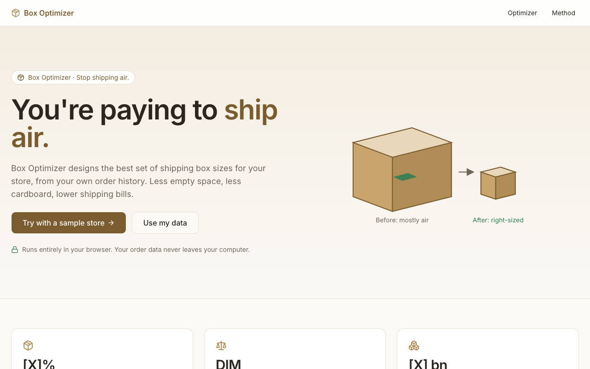
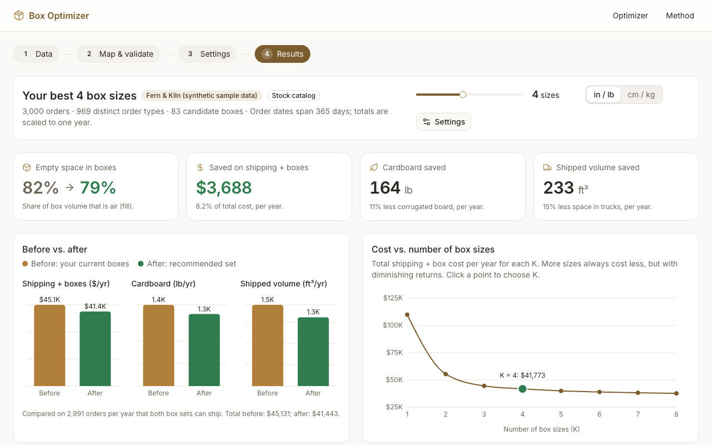
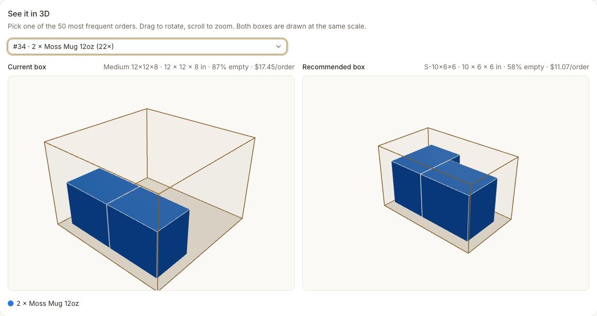
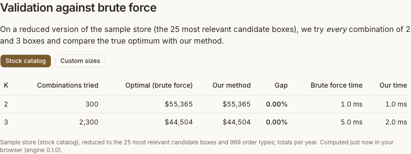
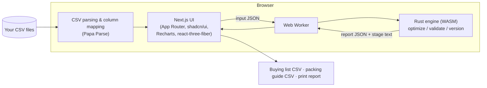

# Box Optimizer (working title)

[](https://github.com/stasdi01/hacknorse/actions/workflows/ci.yml)

> **Stop shipping air.** HackNorse 2026 · Sustainability track

Small online stores buy shipping boxes by guesswork, so many orders ship in boxes much bigger
than the items. That wastes cardboard and truck space, and it costs money, because carriers bill
by **dimensional (DIM) weight**, the size of the box, not only its weight.

This app **designs the box set**. From a store's own order history it chooses the best K box sizes
(from a stock catalog, or fully custom sizes) that minimize total shipping + box cost, and shows the
before/after: empty space, dollars, cardboard and shipped volume. Box-picker apps only choose the
best box among the boxes a seller already owns; our "before" already does that, so the savings come
on top.

Everything runs **in the browser**: a Rust engine compiled to WebAssembly runs in a Web Worker.
Order data never leaves the user's computer. There is no server and no database.

The product name is a placeholder; it lives in one constant, `APP_NAME` in
[`web/src/config/app.ts`](web/src/config/app.ts).

## Screenshots

| Landing                                   | Results dashboard                         |
| ----------------------------------------- | ----------------------------------------- |
|  |  |

| 3D viewer (current vs. recommended box)       | Validation against brute force (/method)          |
| --------------------------------------------- | ------------------------------------------------- |
|  |  |

## Run it locally (step by step)

You only need Node and pnpm to run the app. The compiled engine (`web/src/engine-wasm/`) is
committed, so Rust is only needed if you change the engine.

1. **Install Node.js 20 or newer** (`node -v` to check). <https://nodejs.org>
2. **Install pnpm 9**:
   ```bash
   npm install -g pnpm@9
   ```
3. **Get the code** and go to the web app:
   ```bash
   git clone https://github.com/stasdi01/hacknorse.git
   cd hacknorse/web
   ```
4. **Install dependencies**:
   ```bash
   pnpm install
   ```
5. **Start the development server**:
   ```bash
   pnpm dev
   ```
   Open <http://localhost:3000> and click **Try with a sample store**.
6. **Or run the production build**:
   ```bash
   pnpm build && pnpm start
   ```
   Open <http://localhost:3000>.

### Changing the engine (optional)

1. Install Rust (stable) with rustup: <https://rustup.rs>
2. Add the WebAssembly target and wasm-pack:
   ```bash
   rustup target add wasm32-unknown-unknown
   cargo install wasm-pack   # or: curl https://rustwasm.github.io/wasm-pack/installer/init.sh -sSf | sh
   ```
3. Rebuild the engine into `web/src/engine-wasm/` (commit the output):
   ```bash
   scripts/build-wasm.sh
   ```

### Regenerating the sample store (optional)

The synthetic "Fern & Kiln" store (40 SKUs, 3,000 orders over 2025) is generated with a fixed seed:

```bash
cd web && pnpm generate-sample   # writes web/public/sample/*.csv
```

## Using your own data

Upload CSV files (templates can be downloaded in the app):

| File                | Columns                                                          |
| ------------------- | ---------------------------------------------------------------- |
| `products.csv`      | `sku, name, length_in, width_in, height_in, weight_lb`           |
| `orders.csv`        | `order_id, sku, quantity` (+ optional `order_date`), one row per line item |
| `current_boxes.csv` | `box_id, length_in, width_in, height_in, unit_cost_usd` (optional) |

Column names from Shopify, Etsy or WooCommerce exports (e.g. `Lineitem sku`, `Name`, `Created at`)
are matched automatically, and you can correct the mapping. Units in headers (`Length (cm)`,
`Variant Grams`) are detected; there is also a metric display toggle.

## Architecture



```
engine/            Rust crate (lib + wasm bindings)
  src/             types, config, prep, candidates, packer, cost, optimizer,
                   baseline, pipeline, validate, lib (JSON API)
  data/            stock_boxes.json (83 stock sizes)
  tests/           integration, property and brute-force tests
web/               Next.js app
  src/config       app.ts (APP_NAME)
  src/engine       types.ts, defaults.ts, worker.ts, client.ts
  src/engine-wasm  compiled engine (generated by wasm-pack, committed)
  src/lib/data     CSV parsing, column mapping, validation, units
  public/sample    sample store CSVs
scripts/           build-wasm.sh, generate-sample.ts
bench/             Python packer benchmark (stretch goal)
docs/              PRD, METHOD, PROGRESS, DECISIONS, screenshots
```

The engine ↔ web boundary is JSON only. `engine/src/types.rs` and `web/src/engine/types.ts` are kept
identical, and so are `engine/src/config.rs` and `web/src/engine/defaults.ts`; web tests parse the
Rust files and fail if they drift.

## How the algorithm works

Full write-up: [docs/METHOD.md](docs/METHOD.md) and the `/method` page in the app.

1. **Pre-process:** expand line items, look up dimensions and weights, group identical orders
   into order types ("signatures") with a count, annualize from order dates.
2. **Candidates:** about 80 stock box sizes, or (custom mode) a tight box designed for each order
   type, rounded up to 0.5 in, at most 300.
3. **Fit check (packer):** single items use an exact rule (sorted dims); several items use an
   extreme-point heuristic (Crainic, Perboli & Tadei, 2008, simplified). It is conservative:
   every "yes" comes with a real, overlap-free placement.
4. **Cost:** billable weight = max(actual, DIM), rounded up to a whole lb; shipping from the rate
   table plus the box price. Also empty space, cardboard weight and shipped volume.
5. **Choose K boxes (p-median):** greedy, then swap local search, from a few deterministic
   starts, for K = 1..8 (the savings-vs-K curve). Every order that fits some box must be served.
6. **Baseline:** each order in the cheapest of the seller's current boxes (box-picker behavior).
7. **Validation:** brute force over every 2- and 3-box combination of a reduced 25-candidate
   instance. On the sample store the gap is **0.00%**.

Sample store results (default settings, K = 4): stock catalog saves about **8%** of shipping + box
cost (empty space 82% → 79%); custom sizes save about **10%** (82% → 77%). Native run time 0.1 s
(stock) and 0.25 s (custom).

## Tests

```bash
# Engine
cd engine
cargo fmt --check
cargo clippy --all-targets -- -D warnings
cargo test              # unit, property (proptest), brute-force and sample-store tests

# Web
cd web
pnpm lint               # ESLint + Prettier
pnpm test               # Vitest: mapping, units, validation, exports, Rust/TS sync
pnpm build
pnpm test:e2e           # Playwright against `pnpm start` (run `pnpm build` first)
```

Playwright uses the locally installed Google Chrome. Without Chrome, install Playwright's
browser and run with the bundled Chromium:

```bash
pnpm exec playwright install chromium
PW_CHANNEL="" pnpm test:e2e
```

CI (GitHub Actions) runs all of the above on every push.

## Assumptions (verify before presenting)

All constants live in [`engine/src/config.rs`](engine/src/config.rs) and
[`web/src/engine/defaults.ts`](web/src/engine/defaults.ts), marked `ASSUMPTION: verify before presenting`.

| Constant                     | Value                                                  | Status                       |
| ---------------------------- | ------------------------------------------------------ | ---------------------------- |
| DIM divisor UPS/FedEx-style  | 139 in³/lb                                             | verify with carrier          |
| DIM divisor USPS-style       | 166 in³/lb, only above 1,728 in³ (1 ft³)               | verify with carrier          |
| Rate table                   | $8.50 at 1 lb + $0.95 per extra lb (to 70 lb)          | illustrative, editable in UI |
| Board weight                 | 0.13 lb/ft² (single wall)                              | verify with supplier         |
| Stock box price              | $0.20 + $0.0015 × surface area (in²)                   | estimate                     |
| Custom box price             | stock formula × 1.25                                   | estimate                     |
| Padding                      | 0.5 in per side (0–2 in in UI)                         | default                      |
| Landing-page facts           | placeholders                                           | team to fill in with sources |

## Project docs

- [docs/PRD.md](docs/PRD.md): specification
- [docs/METHOD.md](docs/METHOD.md): method details
- [docs/PROGRESS.md](docs/PROGRESS.md): milestone checklist
- [docs/DECISIONS.md](docs/DECISIONS.md): decisions where the PRD was open

Deployment is not part of this build (the team deploys `web/` to Vercel later).
