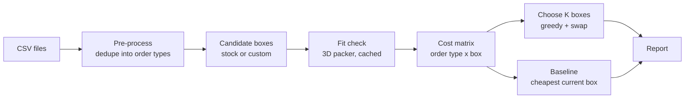

# Method

How the box-set optimizer turns order history into a recommended set of box sizes. The same
content, with a live validation run, is on the `/method` page of the app.

## 1. Pipeline

All units are inches, pounds and US dollars inside the engine.

## 2. Pre-processing (`engine/src/prep.rs`)

- Line items with an unknown SKU or zero quantity are skipped and counted.
- Each order's items are grouped into a **signature** (SKU → quantity). Identical signatures are
  deduplicated with a count; ids are frequency ranks (0 = most frequent).
- Orders with more than 40 items are excluded and flagged ("too large for MVP").
- **Annualization:** if orders have dates, totals are multiplied by 365 / (days spanned).
  Without dates the dataset is treated as one year, and the UI says so.

## 3. Candidate boxes (`engine/src/candidates.rs`)

- **Stock mode:** 170 standard corrugated sizes (`engine/data/stock_boxes.json`): 16 cubes from
  4 to 24 in, small sizes in 1-inch steps (5×4×3 up to 12×12×10) and larger standard sizes up to
  24×24×12. Unit cost estimate: `0.20 + 0.0015 × surface area (in²)`.
- **Custom mode:** one tight box per signature.
  - Single item: sorted item dims + 2 × padding, rounded up to 0.5 in.
  - Several items: the smallest (by volume) of three layouts, each confirmed by the packer: a
    "compact" packing in a 60 in container (each item placed where the bounding box grows least),
    the plain extreme-point packing, and a near-cube box grown in 5% steps from the cube root of
    the item volume. Bounding box + padding, rounded up to 0.5 in.
  - Deduplicate; above 300 sizes keep those used by the most orders, then add back any size
    needed so every packable order still fits a candidate.
  - Unit cost estimate: stock formula × 1.25 (custom sizes usually need a minimum order quantity).
- Optionally, the seller's current boxes can be added as candidates.

## 4. Packer (`engine/src/packer.rs`)

Usable space = interior − 2 × padding on each axis.

1. **Fast rejects:** total item volume larger than the usable volume, or any item whose sorted
   dims do not fit the sorted usable dims.
2. **Single item (exact):** fits iff sorted item dims ≤ sorted usable dims element-wise.
3. **Several items (extreme-point heuristic,** Crainic, Perboli & Tadei 2008, simplified):
   - Order items by volume (tie: longest side). Extreme points start at (0, 0, 0).
   - For each item, try points sorted by (z, y, x) and all 6 orientations; place it at the first
     position inside the box that overlaps no placed item.
   - After placing at (x, y, z) with size (l, w, h), add the points (x+l, y, z), (x, y+w, z),
     (x, y, z+h).
   - If an item cannot be placed, retry with items ordered by longest side.
4. Results are cached per (signature, box).

The heuristic is **conservative**: it can miss a feasible packing, but every "yes" comes with a
valid placement. Property tests check, for thousands of random cases, that placements stay inside
the box, never overlap, use valid orientations, and that single-item answers match the exact rule.

## 5. Cost model (`engine/src/cost.rs`)

For an order type in a box:

- Box weight = surface area (ft²) × 0.13 lb/ft² (single-wall board).
- Actual weight = items + box. DIM weight = L × W × H / 139 (UPS/FedEx-style) or / 166 only
  above 1 ft³ (USPS-style).
- Billable weight = max(actual, DIM), rounded **up** to the next whole lb.
- Shipping = rate table (illustrative: $8.50 at 1 lb + $0.95 per extra lb, extended past 70 lb).
- Void fill = usable volume (interior minus padding on every side) − item volume, priced at
  $0.50 per ft³ by default (editable; an assumption to verify).
- Total = shipping + box unit cost + void fill. This is what the optimizer minimizes.
- Metrics: air shipped = interior volume − item volume (padding included); void fill volume;
  empty space = 1 − item volume / interior volume; cardboard = box weight; shipped volume =
  interior volume.

### Why air volume is the headline, not empty space %

- Padding counts as empty space: the clearance on every side holds no product, so even a perfect
  fit is partly empty, and small products look very "empty" in any box.
- Empty space % is relative: it does not say how much is shipped. Air shipped per year (ft³) is
  absolute; it is what takes truck space, what DIM pricing charges for, and what void fill must
  fill. The results therefore lead with air shipped and void fill needed, and show empty space %
  as a secondary number.

## 6. Choosing K boxes (`engine/src/optimizer.rs`)

This is a **p-median / facility-location** problem: choose K boxes so that the count-weighted sum,
over order types, of the cheapest fitting chosen box is minimal. An order type that fits some
candidate but none of the chosen boxes costs a large penalty, so it is always served when possible.

- **Greedy:** add the box with the largest cost decrease, K times.
- **Swap local search:** evaluate replacing each chosen box with each other candidate, apply the
  best improving swap, repeat until no improvement (at most 50 rounds). Swaps are evaluated
  incrementally with the best and second-best cost per order type.
- **Starts:** plain greedy, the K−1 solution plus one greedy box, and greedy seeded with each of the
  6 best single boxes; the best result is kept. Because one start extends the K−1 solution, the
  cost-vs-K curve never increases.
- Run for K = 1..8 to build the curve; the chosen K is reported in detail.

Deterministic: no randomness, ties broken by index.

## 7. Baseline (`engine/src/baseline.rs`)

Each order type goes in the cheapest fitting **current** box, which is what box-picker apps do.
The before/after summary compares only the orders both box sets can ship; orders that fit none of
the current boxes are flagged and listed.

## 8. Validation (`engine/src/validate.rs`)

The instance is reduced to 25 candidates (the heuristic's K = 1..3 boxes, then the boxes that are
the cheapest fit for the most orders, then the best single boxes). For K = 2 and 3 every combination
is evaluated (300 and 2,300 combinations) and compared with greedy + swap.

| Sample store | K = 2 gap | K = 3 gap |
| ------------ | --------- | --------- |
| Stock        | 0.00%     | 0.00%     |
| Custom       | 0.00%     | 0.00%     |

Unit tests also compare against brute force on many tiny instances built from random box
geometry (exact match) and on adversarial random cost matrices (≤ 1% of cases non-optimal, worst
gap < 5%).

## 9. Performance

Sample store (3,000 orders, 969 order types), native release build: stock mode ≈ 0.1 s, custom
mode ≈ 0.25 s (targets: 2 s and 10 s). In the browser (WASM in a Web Worker, measured on a laptop): stock
80 ms, custom 254 ms of engine time.

## 10. Privacy

The engine runs in a Web Worker inside the browser tab. CSV files are read locally; no order data
is uploaded or stored anywhere.
